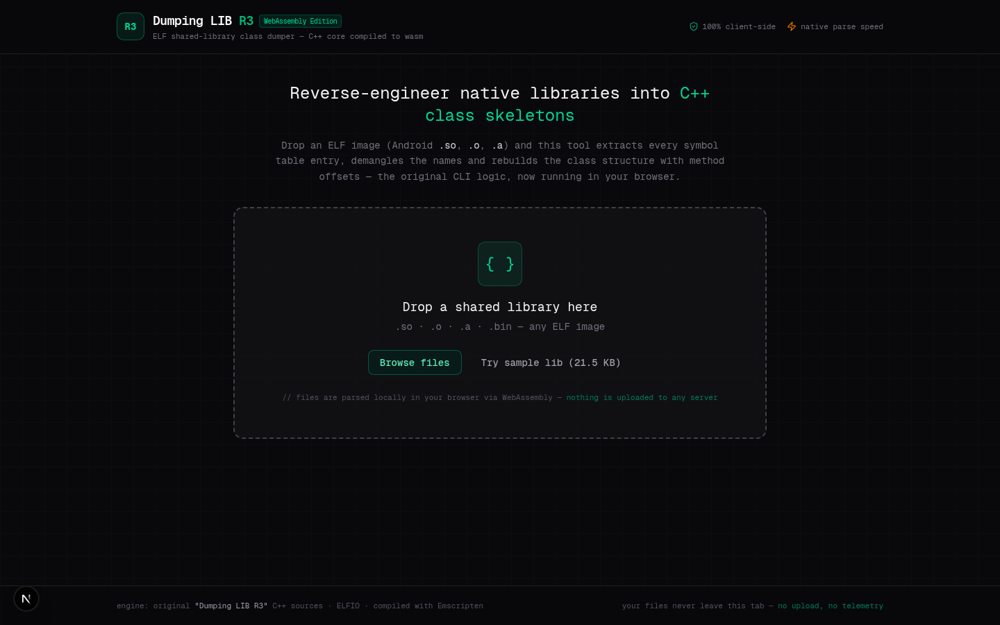
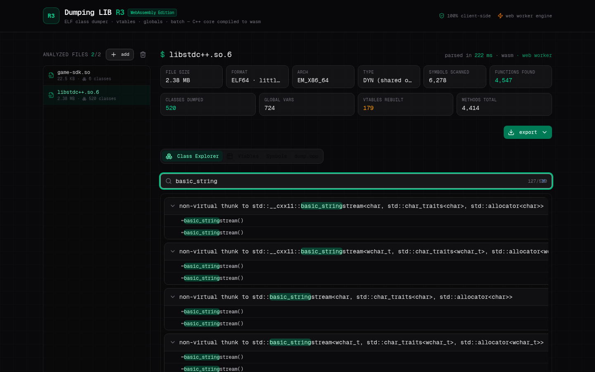
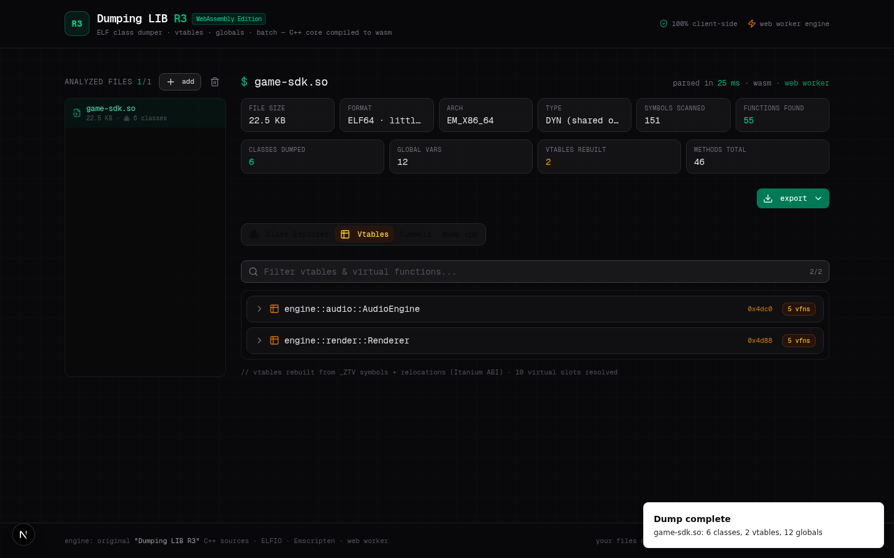
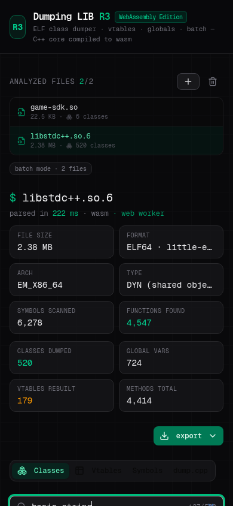

# Dumping LIB R3 — WebAssembly Edition

Drop an ELF shared library (`.so`) in your browser and get back C++ class
skeletons with method **offsets**, reconstructed **vtables**, **global**
symbols, and ready-to-paste `dump.cpp` / IDAPython exports — with the parsing
core being the original **Dumping LIB R3** C++ tool compiled to WebAssembly.

Everything runs **100% client-side**. No uploads, no server, no telemetry —
your binaries never leave your machine.



## Features

- **Drag & drop or browse** — analyze any ELF shared object (`.so`) right in
  the browser; ARM, AArch64 and x86-64 builds all work.
- **Offset dump in the classic format** — every class as a `class Foo { … }`
  block, each entry annotated with `// Offset: 0x… | Size: 0x… | Type: FUNC |
  Mangled: _ZN…`, ASCII-sorted with `::Global` first, exactly like the
  classic offset dumps (VirusModz-style).
- **Class explorer** — searchable tree of every class and method with raw
  offsets; handles libraries with tens of thousands of symbols.
- **Vtable reconstruction** — full Itanium-ABI vtables rebuilt from `_ZTV*`
  symbols plus `.rela`/`.rel` relocations: virtual slots, typeinfo pointers,
  thunks and the emitted target of every slot.
- **Global objects** — STT_OBJECT symbols with sizes, mangled names retained.
- **Batch analysis** — queue many libraries, switch between them in a
  sidebar; each result is kept in memory.
- **Exports** — `dump.cpp` (copy/download), full `analysis.json`, and an
  `ida_rename.py` IDAPython script that applies every mangled name and labels
  vtable slots in IDA.
- **Web Worker engine** — heavy parsing happens off the main thread with a
  main-thread fallback, so even 200 MB libraries keep the UI responsive.
- **Privacy** — there is no backend at all. The WASM binary does the parsing.





## How it works

```
.so file ──▶ Web Worker ──▶ Emscripten WASM (C++ core)
                              │  ELFIO: parse ELF sections
                              │  SYMTAB + DYNSYM scan
                              │  abi::__cxa_demangle
                              │  Itanium vtable reconstruction
                              ▼
                     JSON stats + dump.cpp text
                              ▼
                React UI (class tree, vtables, exports)
```

- `wasm-src/dumper_wasm.cpp` — the original tool's analysis core, adapted to
  a zero-copy in-memory stream over the WASM heap.
- `public/wasm/elf-dumper.{js,wasm}` — prebuilt Emscripten output (committed,
  so CI does not need the SDK).
- `public/workers/elf-worker.js` — worker protocol: `init → ready → analyze
  → result`, with `ArrayBuffer` transfer for zero-copy handoff.
- `src/` — Next.js 16 + React 19 + Tailwind CSS 4 front end (static export).

## Deploy it yourself

### GitHub Pages (recommended)

The included workflow (`.github/workflows/deploy.yml`) builds the site and
publishes it automatically on every push to `main`:

1. Create a new GitHub repository and push this code.
2. In the repo, open **Settings → Pages → Build and deployment** and choose
   **GitHub Actions** as the source.
3. Open the **Actions** tab — the first *Deploy to GitHub Pages* run should
   already be green. Your site is live at
   `https://<user>.github.io/<repo>/`.

The workflow auto-detects the sub-path: project pages build with
`NEXT_PUBLIC_BASE_PATH=/<repo>`, user/org pages (`<user>.github.io` repos)
build for the domain root. The worker derives its WASM path at runtime, so
both layouts work unchanged.

### Any other static host

```bash
bun install
bun run build:static     # emits ./out
```

Upload the contents of `out/` to serv00 `public_html`, Netlify, Cloudflare
Pages, or any Apache/nginx directory. Make sure `.wasm` is served with
`Content-Type: application/wasm` (an `.htaccess` helper for Apache is in
`scripts/package-serv00.sh`).

## Local development

```bash
bun install
bun run dev              # http://localhost:3000
bun run build:static     # production static export
bun run test:wasm        # 24 core assertions against sample/test libs
```

### Rebuilding the WASM core (optional)

The compiled WASM binary is committed, so this is only needed when you change
`wasm-src/dumper_wasm.cpp`:

```bash
# requires the Emscripten SDK (https://emscripten.org)
bash scripts/build-wasm.sh
node scripts/test-wasm.js
```

## Project layout

| Path | What it is |
| --- | --- |
| `wasm-src/dumper_wasm.cpp` | C++ analysis core (ELFIO + demangler + vtable reconstruction) |
| `public/wasm/` | Compiled Emscripten module (glue JS + `.wasm`) |
| `public/workers/elf-worker.js` | Off-main-thread analysis worker |
| `public/sample/game-sdk.so` | Small demo library with virtual classes |
| `src/app/` | Page shell, metadata, global styles |
| `src/components/elf-dumper/` | Upload zone, stats bar, class explorer, dump view, vtables, symbols, sidebar, exports |
| `src/lib/elf-dumper.ts` | Typed bridge to the worker / WASM module |
| `scripts/` | WASM build script, core test harness, serv00 packaging |

## Credits

- **Dumping LIB R3** — the original command-line C++ tool this project ports.
- [**ELFIO**](https://github.com/serge1/ELFIO) — header-only C++ ELF reader/writer.
- [**Emscripten**](https://emscripten.org) — C++ to WebAssembly toolchain.
- Offset-dump output format follows the classic VirusModz dump layout.

## License

[MIT](LICENSE) — the bundled ELFIO library keeps its own MIT license.
